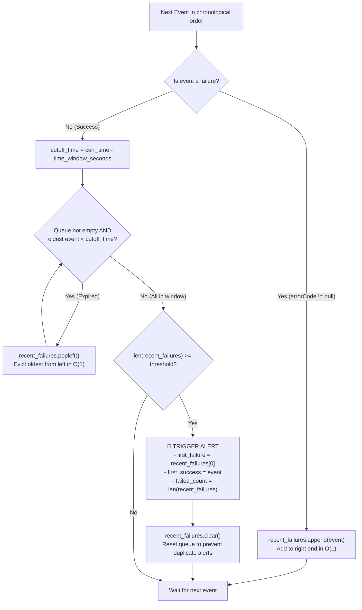
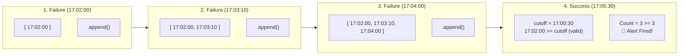

# Understanding Python's `collections.deque`

## 1. What is a `deque`?

`deque` (pronounced **"deck"**) stands for **Double-Ended Queue**. It is part of Python’s standard library in the `collections` module:

```python
from collections import deque
```

It is a sequence-like container designed for fast, memory-efficient appending and popping of elements from **both ends** in $\mathcal{O}(1)$ (constant) time.

---

## 2. Why Not Just Use a Regular Python `list`?

In Python, a standard `list` is implemented under the hood as a **dynamic contiguous array**:
- Adding or removing items at the **end** of a `list` (`list.append()` / `list.pop()`) is fast: $\mathcal{O}(1)$ amortized.
- However, removing or inserting items at the **beginning** of a `list` (`list.pop(0)` or `list.insert(0, item)`) is slow: **$\mathcal{O}(N)$**.

### What happens in memory during `list.pop(0)`?
When you remove the first item from a regular list, Python has to physically **shift every remaining element one index to the left in memory**:

```
Before list.pop(0):
[ item0, item1, item2, item3, item4 ]
    |
    v (removed)

Shift remaining items left:
[ item1, item2, item3, item4 ]   <-- Required 4 memory copies!
```
If your list has 100,000 log events, each `pop(0)` triggers 100,000 memory moves.

### What happens in memory during `deque.popleft()`?
`deque` is implemented internally as a **doubly linked list of fixed-size memory blocks**. Removing the first element simply moves an internal pointer to the next element:

```
[ block 1 ] <---> [ block 2 ] <---> [ block 3 ]
    ^
  head pointer moves forward by 1: O(1) instant!
```
No elements are shifted. Whether the deque holds 10 items or 10,000,000 items, `popleft()` takes the exact same fraction of a microsecond.

---

## 3. Time Complexity Comparison

| Operation | Regular `list` | `collections.deque` | Description |
| :--- | :--- | :--- | :--- |
| **Append right** (`.append()`) | $\mathcal{O}(1)$ | $\mathcal{O}(1)$ | Add item to the end |
| **Append left** (`.appendleft()`) | $\mathcal{O}(N)$ | $\mathcal{O}(1)$ | Add item to the start |
| **Pop right** (`.pop()`) | $\mathcal{O}(1)$ | $\mathcal{O}(1)$ | Remove item from the end |
| **Pop left** (`.popleft()`) | **$\mathcal{O}(N)$** | **$\mathcal{O}(1)$** | Remove item from the start |
| **Access by index** (`q[i]`) | $\mathcal{O}(1)$ | $\mathcal{O}(N)$ middle / $\mathcal{O}(1)$ ends | Random lookup by index |

> [!TIP]
> - Use **`list`** when you need fast random access by index (`my_list[42]`) or mostly append/read items.
> - Use **`deque`** when you need a **Queue (FIFO)**, a **Stack (LIFO)**, or a **Sliding Window** where items are continuously added to one end and removed from the other.

---

## 4. Key Methods and Usage

### Common Operations

```python
from collections import deque

d = deque([10, 20, 30])

# Adding items
d.append(40)         # deque([10, 20, 30, 40])
d.appendleft(0)      # deque([0, 10, 20, 30, 40])

# Removing items
right_val = d.pop()       # removes 40 -> deque([0, 10, 20, 30])
left_val  = d.popleft()   # removes 0  -> deque([10, 20, 30])

# Inspecting endpoints in O(1)
oldest = d[0]   # 10
newest = d[-1]  # 30
```

### Fixed-Size Circular Buffers (`maxlen`)

`deque` supports an optional `maxlen` parameter. Once full, adding a new item automatically discards items from the opposite end:

```python
# Keep only the last 3 events
recent = deque(maxlen=3)

recent.append("event_1")
recent.append("event_2")
recent.append("event_3")
recent.append("event_4")  # "event_1" is automatically dropped!

print(recent)
# Output: deque(['event_2', 'event_3', 'event_4'], maxlen=3)
```

---

## 5. Why `deque` Matters in Security & Detection Engineering

Security detections frequently monitor high-throughput event streams for patterns occurring within time or count windows:

1. **Sliding Time Windows (Our Challenge)**:
   - Evicting events that are older than $T - \Delta t$ as new events arrive.
2. **Brute Force & Credential Stuffing Detections**:
   - Tracking the last $N$ failed authentications per user or source IP.
3. **API Rate Limiting (Token Bucket / Sliding Log)**:
   - Ensuring an API key does not exceed $R$ requests per minute by pruning expired request timestamps.
4. **Network Packet Sniffing / Flight Recorders**:
   - Maintaining an in-memory buffer of the last $N$ packets using `deque(maxlen=N)` for forensic analysis when an intrusion alert triggers.

---

## 6. Visualizing the Deque & Sliding Window Cycles

### A. The Per-Event Processing Cycle



### B. The Deque Timeline & Eviction Cycle



---

## 7. How It Is Used in Our Solution

In [`solution.py`](./solution.py):

```python
recent_failures: deque = deque()

for event in events:
    curr_time = parse_timestamp(event["timestamp"])

    if is_failure(event):
        # Push the newest failure to the right
        recent_failures.append(event)
    else:
        # Prune expired failures from the left in O(1) time
        cutoff_time = curr_time.timestamp() - time_window_seconds
        while recent_failures and parse_timestamp(recent_failures[0]["timestamp"]).timestamp() < cutoff_time:
            recent_failures.popleft()

        # Check threshold
        if len(recent_failures) >= threshold:
            ...
```
